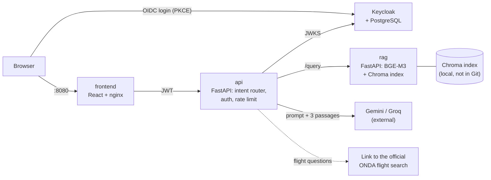

# AGA Digital Terminal — Airport RAG Assistant

A multilingual (French / English / Arabic) assistant prototype for **Agadir Al Massira Airport**.
Passengers ask questions in natural language; the assistant answers from the airport's own PDF
documents (retrieval-augmented generation) and shows the sources it used. Flight status questions are
never answered by the language model: they are redirected to the official ONDA flight search.

> **Internship prototype.** Built during an internship at ONDA (Agadir Al Massira Airport, SITA
> office). It is **not an official ONDA or airport product**, is **not deployed in production**, and
> does not replace the airport's operational systems. The airport's documents are not included in
> this repository (see [Source documents](#source-documents)).

## Architecture



Five containers, three Docker networks. Only the frontend, the API and Keycloak are published on the host.

```
                 ┌─────────────── edge ───────────────┐
  Browser ──────▶│  frontend (nginx)   :8080 -> 80    │
     │           │        │                           │
     │           │        ▼                           │
     │           │  api (FastAPI)      :8001          │◀── also on backend + identity
     │           └────────┼───────────────────────────┘
     │                    │
     │           ┌────────┼──── backend ──────────────┐
     │           │        ▼                           │
     │           │  rag (FastAPI)      8002, internal │
     │           │   ├─ BGE-M3 embeddings             │
     │           │   └─ Chroma index (embedded,       │
     │           │      PersistentClient on disk)     │
     │           └────────────────────────────────────┘
     │
     │           ┌──────────── identity ──────────────┐
     └──────────▶│  keycloak           :8081 -> 8080  │
     (OIDC login)│  keycloak-db (PostgreSQL 16)       │
                 └────────────────────────────────────┘

  api ──▶ Gemini (primary) / Groq (fallback)   external LLM providers
```

- **Chroma is not a separate service.** It is a library inside the `rag` container that opens an
  on-disk index (`backend/chroma_data`, bind-mounted).
- The API validates Keycloak JWTs (RS256, issuer, audience), routes intents, asks the RAG service for
  8 candidate passages, keeps 3, and calls the LLM. If both LLM providers fail, it returns the
  retrieved excerpt instead of an invented answer.
- Retrieved context is passed to the model as data, not as instructions.

## Stack

| Layer | Technology |
|---|---|
| Frontend | React 19, Vite, keycloak-js, nginx |
| API | FastAPI, Pydantic, PyJWT (JWT validation), requests |
| Retrieval | BGE-M3 (`BAAI/bge-m3`) via sentence-transformers, Chroma (embedded), PyMuPDF / pdfplumber / pypdf, optional Mistral OCR |
| Generation | Gemini `gemini-2.5-flash`, Groq `openai/gpt-oss-120b` (fallback) |
| Identity | Keycloak 26 (OIDC, PKCE S256), PostgreSQL 16 |
| Deployment | Docker Compose |

## Repository layout

```
backend/api_service/   public API: /chat, /intent, /documents, auth, rate limit
rag_service/           retrieval service: /query, PDF ingestion, evaluation
  scripts/             ingest_pdfs.py, batch_ingest_pdfs.py, evaluate_retrieval.py
  evaluation/          benchmarks (v1: 30 questions, v2: 150 questions) and saved results
frontend/              React app
keycloak/              realm export (aga-airport) and login theme
docker-compose.yml
```

## Installation

Requirements: Docker Desktop (Compose v2). The first start downloads the BGE-M3 model (~2 GB) unless
a local HuggingFace cache is mounted.

```bash
git clone https://github.com/othmane1244/airport-rag-assistant.git
cd airport-rag-assistant

cp .env.example .env                                      # Keycloak admin + DB passwords
cp backend/api_service/.env.example backend/api_service/.env   # LLM keys
cp rag_service/.env.example rag_service/.env
# edit the .env files, then:
docker compose up --build
```

| URL | Service |
|---|---|
| http://localhost:8080 | Web app |
| http://localhost:8001/docs | API (OpenAPI) |
| http://localhost:8081 | Keycloak admin console |

The `aga-airport` realm is imported on first start. Create a user in Keycloak to log in; give it the
`document-admin` realm role to access the document admin panel.

## Environment variables

| File | Variable | Purpose |
|---|---|---|
| `.env` | `KEYCLOAK_ADMIN_USERNAME`, `KEYCLOAK_ADMIN_PASSWORD` | Keycloak bootstrap admin |
| `.env` | `KEYCLOAK_DB_PASSWORD` | Keycloak PostgreSQL password |
| `.env` | `HF_CACHE_DIR` (optional) | Host HuggingFace cache mounted read-only into `rag` |
| `backend/api_service/.env` | `GEMINI_API_KEY` | Primary LLM |
| `backend/api_service/.env` | `GROQ_API_KEY` | Fallback LLM |
| `backend/api_service/.env` | `AUTH_DISABLED` | Dev only (needs `ENVIRONMENT=development`); forced to `false` in Compose |
| `backend/api_service/.env` | `KEYCLOAK_ISSUER_URL`, `KEYCLOAK_JWKS_URL`, `KEYCLOAK_AUDIENCE` | Token validation |
| `rag_service/.env` | `MISTRAL_API_KEY` (optional) | OCR for scanned PDFs |
| `rag_service/.env` | `RAG_LOCAL_FILES_ONLY` | Load BGE-M3 from local cache only |
| `frontend/.env` | `VITE_API_URL`, `VITE_KEYCLOAK_URL`, `VITE_KEYCLOAK_REALM`, `VITE_KEYCLOAK_CLIENT_ID` | Frontend config (build args in Compose) |

Never commit a `.env` file. Only the `*.env.example` templates are tracked.

## Source documents

No document is shipped with this repository: the PDFs used during the internship belong to the
airport operator, and `rag_service/data/pdfs/` and the vector index are ignored by Git. To try the
assistant, index your own documents as described in
[`rag_service/data/README.md`](rag_service/data/README.md); without any indexed document there is
nothing to answer from.

## Ingesting PDFs

Put PDFs in `rag_service/data/pdfs/`, then run inside the `rag` container:

```bash
# 1. dry run: extraction + deduplication report, nothing is written to the index
docker compose exec rag python scripts/batch_ingest_pdfs.py --dry-run --audience voyageur

# 2. index
docker compose exec rag python scripts/batch_ingest_pdfs.py --audience voyageur
```

Passages are chunked (1,200 characters, 150 overlap; tables and legal articles have dedicated
splitters), embedded with BGE-M3 and stored in the `aga_documents` collection. The `audience` tag
(`voyageur`, `professionnel`, `interne_gouvernance`, `a_qualifier`) filters what passengers can
retrieve. Documents can also be uploaded from the admin panel (`document-admin` role).

## Backing up and restoring the index

The Chroma index lives in `backend/chroma_data` (bind-mounted into the `rag` container) and is not in
Git. Stop the `rag` service while copying so the SQLite file is consistent. Keep backups **outside**
the repository.

```bash
# Backup (Git Bash). Writes a dated copy and a checksum list next to it.
TS=$(date -u +%Y%m%dT%H%M%SZ)
DEST=~/aga-backups/chroma_data-$TS
mkdir -p ~/aga-backups
docker compose stop rag
cp -a backend/chroma_data "$DEST"
docker compose start rag
(cd "$DEST" && find . -type f -exec sha256sum {} \; | sort -k2) > "$DEST.sha256"
```

```bash
# Restore a backup. The current index is moved aside, not deleted.
BACKUP=~/aga-backups/chroma_data-20261108T133557Z     # pick the backup to restore
(cd "$BACKUP" && sha256sum -c --quiet "$BACKUP.sha256") && echo "backup OK"
docker compose stop rag
mv backend/chroma_data "backend/chroma_data.before-restore-$(date -u +%Y%m%dT%H%M%SZ)"
cp -a "$BACKUP" backend/chroma_data
docker compose start rag
curl -s http://localhost:8001/ready
```

Reference backup: `chroma_data-20261108T133557Z` (15,346 passages, 73 with audience `voyageur`).

## Running the backend tests

The API tests are standalone scripts (no network, LLM providers and flight API mocked), not pytest
test files. From `backend/api_service/`, with the API requirements installed:

```bash
pip install -r requirements.txt
python tests/test_intent.py
python tests/test_auth_roles.py
python tests/test_llm_mock.py
python tests/test_flights_mock.py
```

Each script prints its checks and ends with `TOUS LES TESTS PASSENT.` when all of them pass.

## What has been verified

Checked on 2026-11-17 by starting this repository with `docker compose up --build`, with placeholder
passwords, **no LLM API key and no indexed document**:

- **Verified**: the five services start (`keycloak-db`, `rag` and `api` report healthy); the API
  health routes `/health` and `/ready` and the OpenAPI page `/docs` answer 200; the frontend answers
  200; Keycloak imports the `aga-airport` realm and publishes its OpenID configuration; `POST /chat`
  is refused with 401 without a token and with an invalid token. The four backend test scripts pass.
- **Not verified**: logging in as a user through Keycloak, and a real chat answer. Without LLM keys
  and without documents in the index (`aga_documents` was empty), the assistant cannot produce an
  answer; PDF ingestion was not exercised either.

## Running the retrieval benchmark

```bash
docker compose exec rag python scripts/evaluate_retrieval.py \
    --dataset evaluation/benchmark_v2_150.json
```

Results are written to `rag_service/evaluation/results/` as timestamped JSON.

## Measured results

Benchmark `aga-rag-v2-150`, run on 2026-10-10 against the Compose stack
(`evaluation/results/aga-rag-v2-150-baseline-compose-20261010.json`): 150 questions, 50 per
language; 120 answerable, 30 without an answer in the corpus. Top-k = 5, audience `voyageur`.

| | Hit@3 | MRR@5 | Required-source recall@5 |
|---|---|---|---|
| **All (120 answerable)** | **92.5 %** | 0.824 | 0.902 |
| French | 92.5 % | 0.825 | 0.909 |
| English | 95.0 % | 0.854 | 0.909 |
| Arabic | 90.0 % | 0.792 | 0.886 |

Mean retrieval latency: 114 ms (median 110 ms), retrieval only.

**What this measures and what it does not:** these numbers measure whether an expected source
document is *retrieved*. They do **not** measure whether the generated answer is correct, faithful to
its source, or in the right language. The questions and expected sources were written by the author
and have not been reviewed by an airport-domain expert. One run per configuration.

## Limitations

- Generated answers are not yet evaluated (only retrieval is).
- Some routing and source-selection rules are keyword-based and were tuned on the author's own test
  questions, so the benchmark score is likely optimistic.
- No conversation memory: each message is handled on its own.
- The intent router answers "documentary" by default. Off-topic questions that use airport-like words
  therefore reach the LLM, which declines them (14/14 correct refusals on a held-out sample) but
  consumes LLM quota. When the LLM declines, the UI still shows the retrieved sources, which then
  justify nothing (12 of those 14 refusals displayed unrelated sources). Not fixed.
- Flights: the app embeds a third-party departures widget and links to the ONDA flight search; there
  is no live flight API integration.
- The chat rate limit (30 requests/min per account) is in-process memory and does not coordinate
  several workers.
- Keycloak runs in `start-dev` mode over HTTP. This is a development setup, not a production
  deployment.

## Security

- **Authentication**: Keycloak (OIDC, PKCE S256); the API validates RS256 JWTs (issuer, audience,
  signature through JWKS). Document administration requires the `document-admin` realm role.
- **Secrets**: only `*.env.example` templates with placeholder values are tracked; `.env` files are
  ignored. Compose refuses to start without the Keycloak passwords.
- **LLM safety**: flight status is never generated by the model; retrieved passages are passed as
  data, not instructions; if both providers fail, the API returns the retrieved excerpt rather than
  an invented answer.
- **Data**: no airport document, index or backup is in the repository.
- **Known gaps**: Keycloak runs in `start-dev` mode over HTTP and the rate limit is in-process (see
  [Limitations](#limitations)).

To report a vulnerability, see [SECURITY.md](SECURITY.md).

## Context

Project carried out during an internship at ONDA (Agadir Al Massira Airport, SITA office).

## Credits

- **Airport photo** (`frontend/src/assets/agadir-airport-real.jpg`): "Agadir Airport - Main Entrance",
  by **Hamza Izourane** (own work), from
  [Wikimedia Commons](https://commons.wikimedia.org/wiki/File:Agadir_Airport_-_Main_Entrance.jpg),
  licensed under [Creative Commons Attribution-ShareAlike 4.0 International (CC BY-SA 4.0)](https://creativecommons.org/licenses/by-sa/4.0/).
  The file is unmodified; the app only crops its display with CSS. This photo is **not** covered by
  the MIT license of the code: it remains under CC BY-SA 4.0 (attribution required, adaptations
  shared under the same license). See also
  [`frontend/src/assets/IMAGE_CREDITS.md`](frontend/src/assets/IMAGE_CREDITS.md).
- **AGA mark** (`keycloak/themes/aga-airport/login/resources/img/aga-mark.svg`): a simple plane
  pictogram used by the login theme; it is not the official ONDA or airport logo.

## License

MIT for the code, see [LICENSE](LICENSE). The airport photo keeps its own license (see
[Credits](#credits)).
